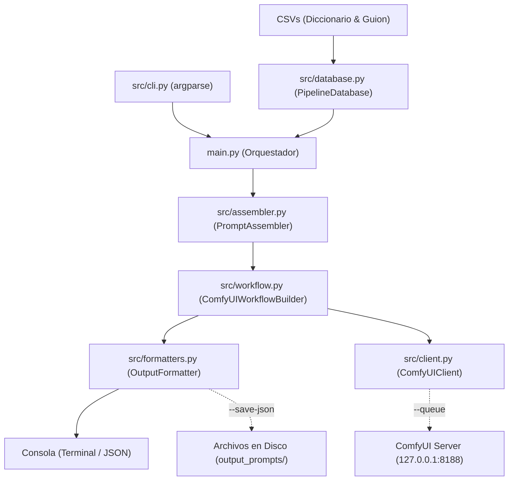

# Mapa Arquitectónico del Pipeline (Guía de Referencia Rápida)

Este documento describe la arquitectura modular del proyecto. Su propósito es servir como índice integral para que cualquier desarrollador o agente de IA pueda entender el sistema completo, localizar funciones específicas y modificar componentes sin necesidad de inspeccionar todo el código fuente.

---

## Índice General

1. [Visión General del Sistema](#visión-general-del-sistema)
2. [Diagrama de Flujo Modular](#diagrama-de-flujo-modular)
3. [Estructura del Proyecto y Archivos](#estructura-del-proyecto-y-archivos)
4. [Detalle por Fichero, Clases y Funciones](#detalle-por-fichero-clases-y-funciones)
   * [1. `main.py` & `pipeline.py`](#1-mainpy--pipelinepy)
   * [2. `src/cli.py`](#2-srcclipy)
   * [3. `src/database.py`](#3-srcdatabasepy)
   * [4. `src/assembler.py`](#4-srcassemblerpy)
   * [5. `src/workflow.py`](#5-srcworkflowpy)
   * [6. `src/client.py`](#6-srcclientpy)
   * [7. `src/formatters.py`](#7-srcformatterspy)
5. [Guía de Navegación Rápida ("Dónde ir si quiero cambiar X")](#guía-de-navegación-rápida)

---

## Visión General del Sistema

El pipeline toma datos relacionales de dos CSVs (`tablas_pipeline_jeanne_alter.csv` y `escenas_sesion_jeanne_alter.csv`), aplica reglas estrictas de dirección de fotografía (vestuario por capas, exclusión mutua de pose y ajuste dinámico de LoRA), y genera prompts listos para copiar/pegar o grafos JSON compatibles con la API de ComfyUI.

---

## Estructura del Proyecto y Archivos

| Fichero | Líneas | Responsabilidad General |
| :--- | :--- | :--- |
| `main.py` | ~120 | Orquestador principal del ciclo de vida del pipeline. |
| `pipeline.py` | ~10 | Alias de compatibilidad hacia `main.py`. |
| `src/__init__.py` | ~20 | Exportación del paquete modular. |
| `src/cli.py` | ~65 | Configuración y parseo de argumentos de línea de comandos. |
| `src/database.py` | ~85 | Lectura, validación y acceso relacional a los CSVs. |
| `src/assembler.py` | ~140 | Reglas de fotografía: ensamble, capas de ropa, poses y random. |
| `src/workflow.py` | ~100 | Generador del grafo de nodos JSON para `/prompt` en ComfyUI. |
| `src/client.py` | ~50 | Cliente HTTP para verificar y enviar prompts a ComfyUI. |
| `src/formatters.py` | ~110 | Presentación en terminal, formato JSON y exportación a disco. |
| `README.md` | - | Documentación de usuario y parámetros. |
| `ARCHITECTURE.md` | - | Este mapa arquitectónico. |

---

## Detalle por Fichero, Clases y Funciones

### 1. `main.py` & `pipeline.py`
* **Rol:** Punto de entrada del pipeline. Coordina la lectura, el ensamblaje, la generación de grafos y la salida.
* **Funciones:**
  * `main() -> None`: Orquesta la secuencia completa:
    1. Llama a `parse_arguments()`.
    2. Instancia `PipelineDatabase`.
    3. Conecta con `PromptAssembler` y `ComfyUIWorkflowBuilder`.
    4. Procesa Modo Guionado (`shot`) o Modo Creativo (`random`).
    5. Envía a `OutputFormatter` para imprimir en consola o guardar.
    6. Opcionalmente despacha a `ComfyUIClient` si `--queue` está activo.

---

### 2. `src/cli.py`
* **Rol:** Define la interfaz de línea de comandos (`argparse`).
* **Funciones:**
  * `parse_arguments() -> argparse.Namespace`:
    * `--mode`: `'shot'` (guionado) o `'random'` (creativo).
    * `--shot-id`: Toma específica (ej. `SHOT-01`) o `'all'`.
    * `--count`: Cantidad de iteraciones en modo random.
    * `--steps`, `--width`, `--height`, `--batch-size`, `--cfg`, `--sampler`, `--scheduler`, `--seed`.
    * `--checkpoint`: Checkpoint a cargar (default: `WAI-Nsfw-Illustrious-17.safetensors`).
    * `--lora-name`: Nombre del LoRA (default: `jeanne_d_arc_alter_fate.safetensors`).
    * `--format`: `'terminal'` (por defecto, copiar/pegar) o `'json'` (grafo raw).
    * `--save-json` / `--save`: Booleano para forzar escritura en disco (por defecto `False`).
    * `--output-dir`: Carpeta de destino al guardar.
    * `-v` / `--verbose`: Activa desglose conceptual fotográfico.
    * `--outfit`, `--pose-path`, `--luz`: Filtros opcionales para modo random.

---

### 3. `src/database.py`
* **Rol:** Abstracción de datos. Carga los CSVs y provee métodos de consulta rápida indexados por ID y Categoría.
* **Clase:** `PipelineDatabase`
  * `__init__(master_csv, shots_csv)`: Inicializa rutas y estructuras en memoria (`dictionary`, `by_category`, `shots`).
  * `_resolve_path(user_path, fallbacks) -> Path`: Resuelve la ruta del archivo con soporte de nombres alternativos.
  * `_load_master_dictionary() -> None`: Parsea `tablas_pipeline_jeanne_alter.csv`, indexa los 41 bloques atómicos, convierte `LoRA_Strength` a float y agrupa por categoría.
  * `_load_shots() -> None`: Parsea `escenas_sesion_jeanne_alter.csv` con las tomas planificadas.
  * `get_entry(item_id: str) -> Optional[Dict]`: Retorna el bloque atómico asociado al ID (ej. `OUT-01A`, `CAM-01`).
  * `get_entries_by_cat(cat: str) -> List[Dict]`: Retorna todos los bloques pertenecientes a una categoría (`OUTFIT`, `CAM`, `POS`, `ACC`, `EXP`, etc.).

---

### 4. `src/assembler.py`
* **Rol:** El "cerebro" fotográfico. Aplica las reglas del Director de Fotografía para generar prompts coherentes.
* **Clase:** `PromptAssembler`
  * `__init__(db: PipelineDatabase)`: Recibe la base de datos para resolver bloques.
  * `assemble_from_sequence(sequence_ids: List[str], shot_meta: Optional[Dict]) -> Dict`:
    * Resuelve cada ID en la secuencia.
    * Identifica el bloque `OUTFIT`:
      1. Extrae su `LoRA_Strength` dinámico (`0.75` con armadura, `0.60–0.65` sin armadura).
      2. Si tiene `Prompt_Negativo_Extra`, lo concatena con `NEG-01` para supresión de armadura/piezas metálicas.
    * Concatena en orden los tags Danbooru para el Prompt Positivo.
    * Retorna dict con prompts, metadata, LoRA strength y lista de bloques resueltos.
  * `assemble_shot(shot_row: Dict[str, str]) -> Dict`:
    * Resuelve una toma del guion leyendo `Secuencia_IDs` (o reconstruyéndola desde columnas ID individuales).
  * `generate_random_shot(iteration_idx, outfit_id, escena_id, estilo_id, luz_id, pose_path) -> Dict`:
    * **Regla de Pose Única (Exclusión Mutua):**
      * Si Camino A: Selecciona exactamente `1 CAM` + `1 POS` + `1 ACC`.
      * Si Camino B: Selecciona exactamente `1 POSE_PACK` (nunca mezcla con CAM/POS/ACC).
    * Añade libremente actuación (`EXP`), mirada (`MIR`) y luz (`LUZ`).

---

### 5. `src/workflow.py`
* **Rol:** Construye la estructura de grafo requerida por ComfyUI.
* **Clase:** `ComfyUIWorkflowBuilder`
  * `__init__(checkpoint_name, lora_name, steps, cfg, sampler_name, scheduler, width, height, batch_size)`: Almacena parámetros del pipeline.
  * `build_prompt_graph(positive_prompt, negative_prompt, lora_strength, seed, filename_prefix) -> Dict`:
    * Genera el diccionario JSON de 8 nodos estándar:
      * Nodo `1`: `CheckpointLoaderSimple`
      * Nodo `2`: `LoraLoader` (con `strength_model` y `strength_clip` dinámicos)
      * Nodo `3`: `CLIPTextEncode` (Prompt Positivo)
      * Nodo `4`: `CLIPTextEncode` (Prompt Negativo)
      * Nodo `5`: `EmptyLatentImage` (width, height, batch_size)
      * Nodo `6`: `KSampler` (steps, cfg, sampler, scheduler, seed, denoise 1.0)
      * Nodo `7`: `VAEDecode`
      * Nodo `8`: `SaveImage`

---

### 6. `src/client.py`
* **Rol:** Comunicación HTTP / API con ComfyUI.
* **Clase:** `ComfyUIClient`
  * `__init__(server_address: str = "127.0.0.1:8188")`: Guarda la URL del servidor y genera un `client_id` único (UUID).
  * `is_server_reachable() -> bool`: Consulta `http://{server}/system_stats` con timeout corto para verificar si el servidor está en línea.
  * `queue_prompt(prompt_graph: Dict) -> Optional[str]`: Hace POST a `http://{server}/prompt` con el payload JSON. Retorna el `prompt_id` asignado o `None` en caso de fallo.

---

### 7. `src/formatters.py`
* **Rol:** Capa de presentación y persistencia. Separa el formato visual de la lógica del pipeline.
* **Clase:** `OutputFormatter`
  * `print_terminal_shot(shot: Dict, args, shot_seed: int) -> None`:
    * Imprime encabezado con parámetros de cámara y toma.
    * Si `-v` está activo, imprime el desglose de cada bloque (`[ID] Categoria - Concepto -> Intención`).
    * Imprime los bloques `[PROMPT POSITIVO - COPIAR Y PEGAR]` y `[PROMPT NEGATIVO - COPIAR Y PEGAR]`.
  * `print_json(batch_payloads: List[Dict], args) -> None`:
    * Serializa e imprime a `sys.stdout` el JSON compatible con la API de ComfyUI.
  * `save_to_disk(batch_payloads: List[Dict], args, output_dir: str) -> None`:
    * Crea `output_dir` y exporta `sesion_prompts_resumen.txt`, `comfyui_batch_payloads.json` y archivos individuales `<toma_id>_comfy_api.json`.

---

## Guía de Navegación Rápida

| Si necesitas... | Ve directamente a... | Función / Variable a modificar |
| :--- | :--- | :--- |
| **Cambiar cómo se combinan las poses (Camino A vs B)** | `src/assembler.py` | `PromptAssembler.generate_random_shot` |
| **Ajustar el cálculo del LoRA según el outfit** | `src/assembler.py` | `PromptAssembler.assemble_from_sequence` |
| **Modificar qué tags negativos se añaden** | `src/assembler.py` | `PromptAssembler.assemble_from_sequence` |
| **Añadir un nodo nuevo a ComfyUI (ej. FaceDetailer o VAE)** | `src/workflow.py` | `ComfyUIWorkflowBuilder.build_prompt_graph` |
| **Cambiar resolución o steps por defecto** | `src/cli.py` | `parse_arguments` (flags `--steps`, `--width`, etc.) |
| **Cambiar el texto o diseño de la salida en consola** | `src/formatters.py` | `OutputFormatter.print_terminal_shot` |
| **Cambiar cómo se guardan los archivos en disco** | `src/formatters.py` | `OutputFormatter.save_to_disk` |
| **Cambiar endpoint o autenticación de ComfyUI** | `src/client.py` | `ComfyUIClient.queue_prompt` |
| **Añadir columnas o campos nuevos a los CSVs** | `src/database.py` | `PipelineDatabase._load_master_dictionary` |
